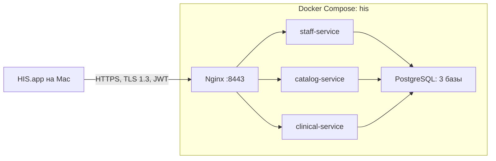

# Самостоятельный запуск и защита лабораторной 2

## Что запускается

Backend целиком описан в корневом `compose.yaml`. Это один Docker Compose-проект `his`, внутри которого пять контейнеров:

| Компонент | Назначение |
|---|---|
| `nginx` | Общая точка входа `https://localhost:8443`; принимает TLS 1.3 и направляет запросы в сервисы |
| `staff-service` | Медработники, аккаунты, вход, TOTP администратора, выдача токенов, проверка прав, аудит |
| `catalog-service` | Справочник диагнозов |
| `clinical-service` | Пациенты, ЭМК, назначения и история |
| `postgres` | Три отдельные базы: staff, catalog, clinical; данные сохраняются в Docker volume |

Приложение **HIS.app** запускается на самом Mac: это нативный SwiftUI-интерфейс. Его не нужно помещать в Linux-контейнер.



TLS защищает соединение клиента с Nginx. Внутри сети Docker сервисы общаются по HTTP. Межсервисные проверки безопасности используют отдельный ключ. Подробности — [security.md](security.md).

## Подготовка один раз

Нужны работающий Docker Desktop с Docker Compose, Xcode 16+, OpenSSL и Python 3. Откройте Docker Desktop и дождитесь готовности движка.

Из корня репозитория, при доступном интернете:

```sh
make prepare
```

Команда создаёт отсутствующие учебные сертификаты и ключи, загружает PostgreSQL/Nginx, собирает три Go-образа и `macos/build/HIS.app`. Если полный набор ключей уже есть, он сохраняется. Пароли, аккаунты и TOTP не переустанавливаются.

На этом ноутбуке образы и зависимости уже подготовлены. Если Docker Hub недоступен, но нужно пересобрать изменённый код:

```sh
make prepare-local
```

Этот вариант компилирует текущие исходники установленным Go для архитектуры Docker и использует локальные runtime-образы. Он запрещает скачивание Go-зависимостей и не выполняет сетевых шагов в Dockerfile. Для него нужны Go 1.26+ и ранее загруженные зависимости/образы; на совершенно новом компьютере сначала нужен обычный `make prepare` или перенос подготовленных образов и зависимостей. Ничего копировать из `/tmp` вручную не требуется.

На этом Mac проект использует **Docker Desktop**. В локальном, игнорируемом Git файле `deploy/docker-context` записано `desktop-linux`; команды проекта читают его и не переключают общий контекст Docker. Проект в Colima остановлен, запускать Colima для лабораторной не нужно.

На другом компьютере без этого файла используется текущий Docker-контекст. Базы и образы разных движков независимы; данные автоматически между ними не переносятся. `make status` показывает выбранный контекст.

После первой подготовки установите доверие к учебному CA в macOS. Это отдельный ручной шаг, описанный ниже.

## Каждый запуск, включая защиту: кнопка в Docker Desktop

1. Откройте **Docker Desktop → Containers**.
2. Найдите группу **his** и нажмите **▶ у всей группы**. Запустятся PostgreSQL, три Go-сервиса и Nginx. Подождите примерно 15–30 секунд до готовности компонентов.
3. Откройте `macos/build/HIS.app` двойным щелчком в Finder.

Чтобы остановить backend, нажмите **■ у группы his**. Контейнеры, образы, база, аккаунты и настройки останутся на месте. На следующей защите снова достаточно ▶.

Нажимать Run отдельно у каждого образа во вкладке Images не нужно: проект Compose уже связывает пять контейнеров, сеть, сертификаты, порты и том данных. Образы — шаблоны отдельных компонентов; группа **his** — готовый набор всего backend.

Для сервисов задан `restart: unless-stopped`: при одновременном старте всей группы Go-сервисы смогут повторить запуск, если PostgreSQL ещё поднимается. При перезапуске Docker Desktop ранее работающие контейнеры также запускаются снова; вручную остановленная группа ждёт вашего ▶.

Из терминала тот же набор можно поднять вместе с открытием приложения:

```sh
make demo
```

При запуске нет пересборки, скачивания образов и изменения ключей. Docker Desktop должен быть включён.

Полезные команды:

| Команда | Результат |
|---|---|
| `make demo` | Backend и нативное приложение |
| `make up` | Только backend, без сборки и скачиваний |
| `make status` | Состояние контейнеров; для пяти компонентов должно быть `healthy` |
| `make doctor` | Проверка контейнеров, наличия приложения, TLS 1.3, имени localhost и отказа API без входа |
| `make down` | Удаление контейнеров группы с сохранением данных и образов; для обычной остановки удобнее ■ в Desktop |
| `make cert-info` | Subject, Issuer, даты и отпечатки публичных сертификатов; проверка подписи |
| `make help` | Список команд |

Для остановки клиента используйте HIS → Завершить HIS (`⌘Q`). После `make down` следующий `make demo` вернёт ту же базу с теми же аккаунтами и историей. Docker volume содержит данные и TOTP-настройку администратора. Каталог `deploy/security/` содержит соответствующие сертификаты и ключи.

Если изменился backend, сначала выполните `make prepare` или `make prepare-local`, потом `make demo`: простой запуск намеренно не пересобирает код. Для изменения только Swift достаточно `make macos-build`.

## Что за сертификаты

Сертификат — публичное удостоверение сервера: «этот открытый ключ принадлежит localhost, а удостоверение подписал такой-то издатель». Закрытый ключ нужен серверу, чтобы доказать владение этим удостоверением. Сам сертификат можно показывать на защите; закрытые ключи и пароли показывать не нужно.

В нашей лабораторной есть два вида сертификатов:

1. **Корневой CA**, `deploy/security/tls/ca/ca.crt`. Это наш учебный издатель **HIS Teaching Root CA**. Он подписал сертификат сервера. Мы явно добавляем его в доверенные на своём Mac, потому что macOS не знает о нашем самостоятельно созданном издателе.
2. **Серверный сертификат**, `deploy/security/tls/server/server.crt`. Его Nginx предъявляет приложению при подключении. Он выписан на `localhost`; в SAN также есть `127.0.0.1` и `::1`.

Связь выглядит так:

```text
macOS доверяет нашему CA
        ↓ проверяет подпись
сертификат localhost подписан этим CA
        ↓ проверяет имя сервера и срок действия
HIS устанавливает защищённое соединение с Nginx
```

**Subject** — кому принадлежит сертификат. **Issuer** — кто его подписал. У корневого сертификата Subject и Issuer совпадают: он самоподписанный. У серверного Subject — `localhost`, Issuer — `HIS Teaching Root CA`.

Поля `O=ITMO` и `OU=MedSoft 2026/27 367907` — организация и подразделение из задания. `CN` — общее имя, а проверка допустимого адреса соединения опирается на SAN.

| Файл | Для чего нужен |
|---|---|
| `tls/ca/ca.crt` | Публичный сертификат издателя; его импортируют в доверенные macOS |
| `tls/ca/ca.key` | Закрытый ключ издателя; нужен для подписи серверного сертификата, в контейнеры не передаётся |
| `tls/server/server.crt` | Публичный сертификат localhost, который показывает Nginx |
| `tls/server/server.key` | Закрытый ключ Nginx для TLS |
| `jwt/signing.key` | Отдельный ключ подписи JWT; к TLS-сертификатам не относится |
| `services/service.key` | Отдельный секрет для внутренних запросов между сервисами; к TLS-сертификатам не относится |

TLS шифрует канал и подтверждает сервер. Логин, TOTP и JWT определяют пользователя и разрешённые ему действия. Это разные части защиты.

Все перечисленные файлы находятся в игнорируемом Git каталоге. Обычно их создают один раз; повторный запуск использует их снова.

### Как настроить доверие один раз

```sh
open deploy/security/tls/ca/ca.crt
```

Импортируйте CA в приложение «Связка ключей», в связку «Вход». Откройте **HIS Teaching Root CA**, раскройте **Доверие**, выберите **Всегда доверять для SSL** и подтвердите изменение средствами macOS. Импортируется публичный `ca.crt`, а не `ca.key` и не серверный сертификат.

После этого в HIS нажмите «Повторить подключение». В настройках приложения должен быть адрес `https://localhost:8443`.

При недоверенном CA приложение отклоняет соединение. Оно не принимает любой сертификат автоматически и не отключает системную проверку.

### Что показывать преподавателю

В HIS откройте **HIS → Сертификаты сервера…** и нажмите **Проверить подключение**. Кнопка создаёт новое TLS-соединение и показывает настоящий полученный сертификат: Subject, Issuer, сроки действия, SHA-256 и PEM. Сравните Subject и Issuer; укажите `ITMO` и свой ИСУ в OU.

`make cert-info` показывает сертификаты из файлов. Окно HIS показывает сертификаты соединения — именно оно отвечает дополнительному требованию для небраузерного клиента. В `serverTrust` macOS может добавить корневой сертификат из своего хранилища.

## Сценарий защиты

1. Нажмите ▶ у группы **his** в Docker Desktop, откройте HIS.app и выполните `make doctor`. Покажите пять контейнеров в группе.
2. Покажите окно сертификатов и объясните CA → сертификат localhost → системную проверку доверия. Соединение клиента защищено TLS 1.3.
3. Войдите администратором. При самом первом входе задайте пароль с подтверждением, добавьте показанный секрет в приложение-аутентификатор и подтвердите шестизначный код. При следующих входах используйте пароль и текущий TOTP.
4. Создайте медработников с ролями doctor, nurse, other. Для каждого выберите «Создать аккаунт», задайте логин и сохраните выданный пароль. Генерация пароля на сервере — 12 букв/цифр. Хранится bcrypt-хэш.
5. Войдите врачом, создайте пациента и ЭМК, разблокируйте карту, добавьте диагноз и назначение, сохраните. Диагнозы предварительно добавляет администратор или импортирует `examples/diagnoses.json`. Покажите историю и прошлое состояние ЭМК.
6. Войдите медсестрой: можно создавать пациентов и ЭМК, но нельзя разблокировать ЭМК для изменений. Войдите other: можно просматривать данные, создавать пациентов и ЭМК нельзя. Сервер проверяет эти ограничения независимо от кнопок интерфейса.
7. Вернитесь администратором, покажите «Аккаунты» и «Аудит». Измените активность, пароль либо роль сотрудника: соответствующие refresh-токены отзываются, их количество фиксируется в аудите. Уже выданный access живёт максимум 5 минут.
8. Попробуйте неправильный пароль и покажите запись неуспешного входа в аудите. Аудит обновляется каждую секунду и не имеет действий редактирования/удаления.

Настройте администратора и подготовьте учебные записи до защиты. Неизвестного «пароля по умолчанию» нет: пароль задаёте вы. Не удаляйте приложение-аутентификатор с записью администратора: восстановления TOTP в задании нет.

## Резерв готовых образов для работы без интернета

```sh
make images-save
```

Получится `build/his-images.tar` со всеми пятью Docker-образами. При необходимости восстановить образы:

```sh
make images-load
make demo
```

Архив образов не содержит данные PostgreSQL, локальные сертификаты/ключи и приложение HIS. На том же ноутбуке они уже находятся в Docker volume, `deploy/security/` и `macos/build/HIS.app`. Это резерв образов, не полная копия системы. Образы привязаны к архитектуре: для этого Mac — ARM64; для Intel их нужно отдельно подготовить под AMD64.

При обычном показе на своём ноутбуке достаточно подготовленных образов, сохранившихся ключей/данных и `make demo`. Интернет при запуске не нужен.
